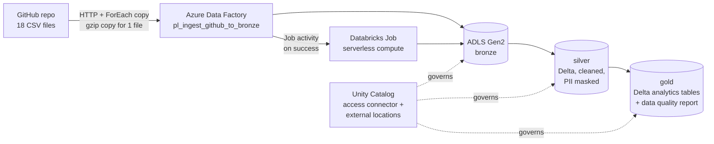
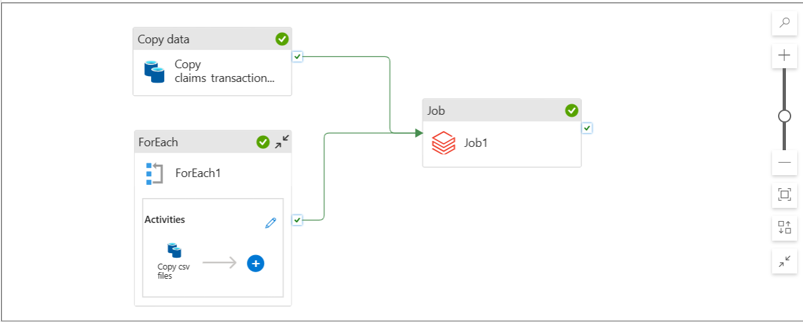
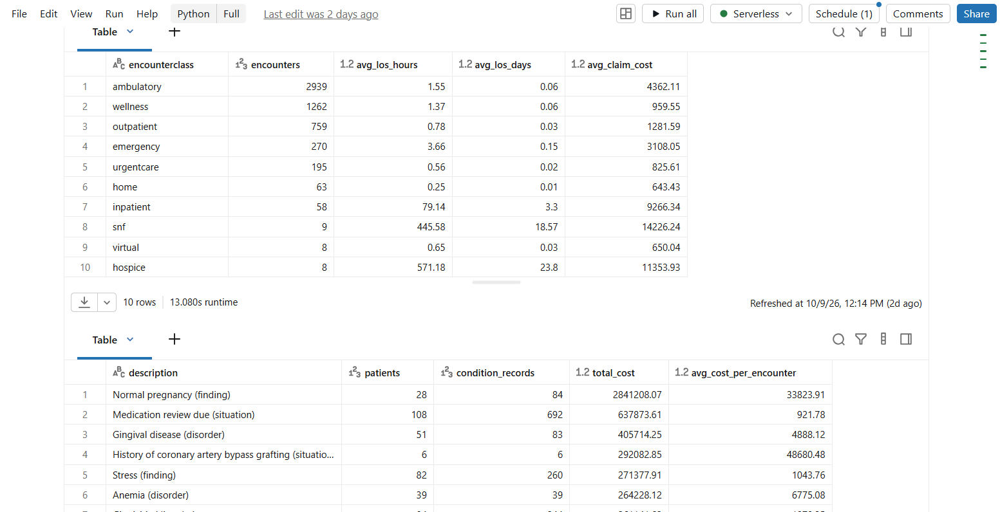

# Azure Databricks Healthcare Pipeline

An end-to-end data engineering project on Azure. Synthetic patient records are pulled from GitHub by **Azure Data Factory**, landed in **ADLS Gen2**, and transformed through a **medallion architecture** (bronze → silver → gold) in **Azure Databricks** using **Delta Lake** and **Unity Catalog**. A single Data Factory pipeline runs the whole flow, from raw CSV to analytics-ready tables.

## Architecture





## Dataset

[Synthea](https://github.com/synthetichealth/synthea) generates realistic but fully synthetic patient records, so there are no privacy or licensing concerns. This project uses a cohort of **108 patients** exported as **18 related CSV files**: patients, encounters, conditions, medications, procedures, observations, immunizations, allergies, care plans, devices, imaging studies, supplies, claims, claims transactions, payers, payer transitions, providers and organizations.

The largest file, `claims_transactions.csv` (about 37 MB), exceeds GitHub's 25 MB browser upload limit. It is stored in the repo as `claims_transactions.csv.gz` (3.7 MB) and decompressed by Data Factory during ingestion.

## Pipeline stages

### 1. Ingestion (Azure Data Factory)
- An **HTTP linked service** reads the raw files from `raw.githubusercontent.com` (anonymous, public repo).
- A **ForEach** loop driven by an array parameter (`fileList`) copies the 17 plain CSVs in parallel into `bronze/healthcare/`.
- A separate **Copy activity** reads `claims_transactions.csv.gz` with gzip compression and writes a plain CSV, so every table lands in bronze in the same format.

### 2. Silver (Databricks)
- Column names standardised to lowercase, string columns trimmed, exact duplicate rows removed, and an `_ingested_at` timestamp added.
- Every table is written as a **Delta** table.
- **Patient privacy:** SSN, driver's licence and passport numbers are replaced with SHA-256 hashes, and names and address are dropped. Derived fields `age` and `is_deceased` are added.

| Table | Bronze rows | Silver rows |
|---|---|---|
| patients | 108 | 108 |
| encounters | 5,571 | 5,571 |
| conditions | 3,517 | 3,517 |
| claims | 9,421 | 9,421 |
| claims_transactions | 85,047 | 85,047 |
| observations | 68,648 | 68,630 (18 duplicates removed) |
| supplies | 2,225 | 2,214 (11 duplicates removed) |
| *other 11 tables* | unchanged | unchanged |

### 3. Data quality
Seven automated checks run on every execution and are saved to `gold/dq_report` with a timestamp: age outside 0–120, null patient IDs, death before birth, encounters ending before they start, negative claim costs, orphan encounters (patient not in patients), and null patient IDs in claims. **All seven passed with 0 failing rows.**

### 4. Gold
| Table | What it answers |
|---|---|
| `los_by_class` | Encounter volume, average length of stay and average claim cost by encounter class |
| `readmission_by_year` | 30-day inpatient readmission rate per year |
| `cost_by_condition` | Patients, records and total/average cost per condition |
| `diabetic_cohort` | Diabetic patients with 3+ encounters in a year, with demographics |

### 5. Orchestration
The Data Factory pipeline ends with a **Databricks Job activity** that starts only after all 18 files have landed in bronze (both the ForEach and the gzip copy must succeed). The job runs the notebook on **serverless compute**, so there is no cluster to manage or shut down.

## Results

**Length of stay and cost by encounter class**

| Class | Encounters | Avg length of stay | Avg claim cost |
|---|---|---|---|
| ambulatory | 2,939 | 1.55 hours | 4,362.11 |
| emergency | 270 | 3.66 hours | 3,108.05 |
| inpatient | 58 | 3.3 days | 9,266.34 |
| skilled nursing (snf) | 9 | 18.6 days | 14,226.24 |
| hospice | 8 | 23.8 days | 11,353.93 |

**Highest-cost conditions:** normal pregnancy (2.84M total across 28 patients), medication review due (637.9K, 108 patients) and gingival disease (405.7K, 51 patients).

**30-day readmission rate:** _add your figures from `display(readmit)` here_

**Diabetic cohort:** _add the cohort size from `diabetic_cohort` here_



## Limitations
- **Small sample.** With 108 patients, readmission rates and cohort sizes are illustrative of the method, not statistically meaningful.
- **Overlapping condition costs.** An encounter linked to several conditions counts its full cost under each, so totals in `cost_by_condition` overlap. Many Synthea "conditions" are findings or situations (for example "Medication review due"), not diseases. Filtering on `(disorder)` gives a disease-only view.
- **Duplicate handling.** Dropping exact duplicates is reasonable for observations, but the 11 supplies duplicates may be legitimate repeat entries.
- **Hashing is pseudonymisation, not anonymisation.** Unsalted hashes of low-entropy identifiers can be reversed by brute force. This is acceptable for synthetic data; real patient data would need salted hashing or tokenisation and a proper governance review.

## Challenges and lessons learned
- **Hierarchical namespace.** The storage account was first created without it. The in-place *Data Lake Gen2 upgrade* fixed it, but only after disabling blob and container soft delete, which validation flags as incompatible.
- **GitHub URLs.** Data Factory needs the `raw.githubusercontent.com` URL. The normal `github.com/.../blob/...` link returns an HTML page, not the CSV.
- **Unpublished Data Factory work is lost.** Without Git integration, unpublished pipelines vanish when the session ends, and Data Factory won't publish a pipeline with no activities. The fix was to build and publish a first working activity early and publish after each stage.
- **Serverless-only Databricks workspace.** No classic clusters were available, so storage access uses an **access connector** with a managed identity (Storage Blob Data Contributor) and Unity Catalog external locations. Orchestration uses the newer **Job activity** instead of the legacy Notebook activity, which needs a classic cluster.
- **File events warning.** Creating the external locations showed optional file-event checks failing. Read, write, list and delete all passed, and file events are not needed for this workload.

## Reproduce it
1. Create a resource group, a storage account with **hierarchical namespace enabled** (containers `bronze`, `silver`, `gold`), a Data Factory and an Azure Databricks workspace (Premium tier).
2. Create an **Access Connector for Azure Databricks**, grant it **Storage Blob Data Contributor** on the storage account, then create a Unity Catalog storage credential and external locations for the three containers.
3. Put the CSVs in `datasets/` of a public GitHub repo and import the Data Factory pipeline from `adf/` (or rebuild it from the stages above).
4. Import `notebooks/01_bronze_to_silver` into Databricks and create a job that runs it on serverless compute.
5. Add an Azure Databricks linked service (Serverless option) and a Job activity pointing at that job. Run the pipeline.

> **Security:** never commit access tokens or storage keys. The Databricks token used by Data Factory is short-lived (30 days) and should be rotated or replaced with managed identity authentication in a production setup.

## Repository structure
```
├── datasets/          # 18 Synthea CSVs (claims_transactions is gzipped)
├── notebooks/         # Databricks notebook (bronze → silver → gold)
├── adf/               # Exported ARM template of the Data Factory
├── docs/images/       # Screenshots used in this README
└── README.md
```

## Tech stack
Azure Data Factory · Azure Data Lake Storage Gen2 · Azure Databricks (serverless) · Delta Lake · Unity Catalog · PySpark · Synthea synthetic data

## Cost control
Built on a free Azure account with a budget alert at 80% of a small monthly limit. Everything is serverless or pay-per-run, so nothing bills while idle.
